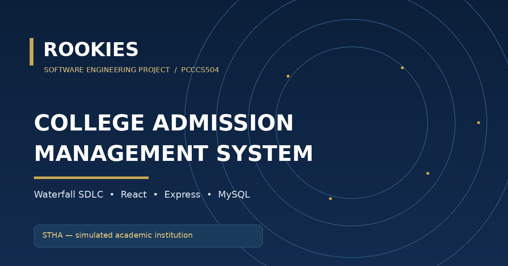

# College Admission Management System (CAMS)

### A Software Engineering Project by Rookies

**Simulated Institution:** STHA  
**Project ID:** CAMS-2026-01  
**Development Model:** Waterfall SDLC  
**Academic Course:** Software Engineering and Project Management (PCCCS504)  
**Department:** Computer Science and Engineering (IoT)  
**Institution:** University of Engineering & Management, Kolkata

> A full-stack academic project demonstrating Software Engineering principles through requirements analysis, system modelling, implementation, testing, security verification and project documentation.

**Project Status:** Implemented and verified academic prototype; eight Waterfall phases internally completed.  
**Deployment:** React frontend deployed to Vercel; Express and MySQL run on the developer's Mac and are reachable through a reusable ngrok HTTPS domain when the laptop and tunnel are on.  
**Live demonstration:** https://cams-rookies-stha.vercel.app/  
**GitHub:** https://github.com/hgaurav1801/CAMS-Rookies-STHA

---

## 1. Project Overview

The College Admission Management System (CAMS) is a web-based platform developed to simulate and manage college admissions.

It provides distinct interfaces for students, admission administrators and college management.

The project follows the Waterfall Software Development Life Cycle, with each phase supported by appropriate engineering documentation and evidence.

### Project Objectives

- Digitize the student admission workflow.
- Apply course-specific eligibility rules.
- Manage applications and required documents.
- Support administrative verification and decisions.
- Prevent admission beyond available seat capacity.
- Maintain admission history and records.
- Generate demonstration admission confirmations.
- Provide course-wise management reports.
- Demonstrate secure role-based access control.

**Important:** Rookies and STHA are simulated organizations created for this academic project. All applicant information is fictional.

### [Launch the CAMS public website](https://cams-rookies-stha.vercel.app/)

The frontend remains hosted on Vercel. Backend-driven features work **only while the MacBook, Docker/MySQL, Node/Express and ngrok tunnel are online**. The application is not a production deployment and the URL alone does not guarantee API availability. For a live interview, see [3-terminal demo instructions](docs/portfolio/DEMO-STARTUP.md).



---

## 2. Technology Stack

| Layer | Technology |
|---|---|
| Frontend | React 18, Vite 6 |
| Routing | React Router |
| Backend | Node.js, Express |
| Database | MySQL 8.4 |
| Database environment | Docker Compose |
| Validation | Zod |
| Authentication | bcryptjs, server-managed sessions |
| Document uploads | Multer |
| PDF generation | PDFKit |
| Testing | Node.js Test Runner |
| Version control | Git and GitHub |
| Frontend deployment | Vercel (deployed) |
| Demonstration API exposure | ngrok Free fixed development domain (laptop-hosted; not 24/7) |

---

## 3. System Architecture

```text
                    CAMS WEB APPLICATION
                            |
                     React + Vite
                            |
                     HTTP / REST API
                            |
                     Node.js + Express
                            |
           +----------------+----------------+
           |                |                |
      Authentication   Business Logic   File Handling
           |                |                |
           +----------------+----------------+
                            |
                      MySQL Database

Private uploaded documents are stored in a restricted
server-side directory in the local demonstration.
```

The frontend communicates with the backend through REST API endpoints.

MySQL stores student profiles, applications, course details, document metadata, review history, sessions and admission confirmations.

---

## 4. User Roles

### Student

- Register and sign in.
- Maintain student profile.
- Explore available courses.
- Create and edit application drafts.
- Upload four required documents.
- Submit applications.
- Track admission decisions.
- View correction or rejection reasons.
- Download confirmation PDFs after approval.

### Admission Administrator

- View submitted applications.
- Start application reviews.
- Verify supporting documents.
- Request corrections.
- Approve or reject applications.
- Manage fictional course details.
- Check admission eligibility and seat availability.

### College Management

- View admission statistics.
- Monitor course-wise application counts.
- Check approved and rejected applications.
- Review available seats and utilization.
- Access read-only management reports.

---

## 5. Software Development Life Cycle

CAMS was developed using the **Waterfall Model**.

The project follows eight phases, numbered Phase 0 through Phase 7.

| Phase | Main Activities |
|---|---|
| 0 | Project initiation and scope |
| 1 | Feasibility study and planning |
| 2 | Requirements engineering and SRS |
| 3 | System analysis and modelling |
| 4 | System and interface design |
| 5 | Development and integration |
| 6 | Testing and quality assurance |
| 7 | Documentation and academic handover |

Engineering deliverables include:

- Project Charter
- Feasibility Study
- Software Requirements Specification
- Requirements Traceability Matrix
- Data Flow Diagrams
- UML Models
- Entity Relationship Diagram
- Data Dictionary
- Software Design Document
- Test Plan and Test Cases
- Defect Register
- Risk and Project Management Records
- Final Academic Project Report

---

## 6. Implemented Functional Modules

| Module | Function |
|---|---|
| M01 | User registration and authentication |
| M02 | Student profile management |
| M03 | Course management |
| M04 | Application management |
| M05 | Document management |
| M06 | Administrative review and decisions |
| M07 | Admission status tracking |
| M08 | Admission confirmation generation |
| M09 | Management reporting |

### Application Lifecycle

```text
Draft
  |
  v
Submitted
  |
  v
Under Review
  |
  +----> Correction Required
  |               |
  |               v
  |           Resubmission
  |               |
  |               v
  |           Submitted
  |
  +----> Approved
  |
  +----> Rejected
```

---

## 7. Database Design

The system uses nine main database tables:

1. users
2. sessions
3. student_profiles
4. admission_cycles
5. courses
6. applications
7. documents
8. review_history
9. confirmations

The MySQL schema is available at:

`api/sql/schema.sql`

Database transactions and locking are used for admission approval and seat allocation.

---

## 8. Testing and Quality Assurance

CAMS underwent unit, integration, security regression and recovery testing.

### Unit Test Results

| Metric | Recorded result |
|---|---|
| Total tests | 31 |
| Passed | 31 |
| Failed | 0 |
| Final status | PASS |

### Integration Testing

Recorded integration checks covered:

- Authentication and session management
- Student application creation and submission
- Administrator review and approval
- Document verification
- Admission confirmation PDF generation
- Management reporting
- Database consistency

### Security Testing

Security regression checks included:

- Session authentication
- CSRF protection
- Role-based authorization
- Private document ownership
- Cross-student access restrictions
- Concurrent admission approval

### Recovery Testing

An isolated recovery rehearsal restored nine database tables and twelve uploaded files.

### Requirements-Level Test Coverage

The broader academic catalogue contains 42 planned cases:

- 21 evidenced
- 16 partially evidenced
- 5 open

These counts are distinct from the 31 passing automated unit tests.

**Detailed testing report:**

[Testing and Verification Evidence](docs/portfolio/TESTING-EVIDENCE.md)

---

## 9. Defect Identification and Resolution

### DEF-001 — Blank Class X Percentage Validation

During unit testing, a defect was discovered in application validation.

**Problem:** Blank percentage input could be interpreted as numeric zero.

**Detection:** UT-22 initially failed.

**Correction:** Input validation was updated to reject blank and whitespace-only values.

**Verification:** Relevant unit tests and the IT-10 HTTP regression subsequently passed.

This demonstrates the complete defect-management lifecycle:

```text
Test Execution
      |
      v
Defect Detected
      |
      v
Root Cause Analysis
      |
      v
Code Correction
      |
      v
Regression Testing
      |
      v
Defect Closure
```

The original execution logs are retained in the local evidence archive.

---

## 10. Application Screenshots

The following images were captured from the implemented CAMS web application during development and testing.

| Screenshot | View |
|---|---|
| [J-01](docs/phase7/screenshots/J-01.jpg) | Application evidence 01 |
| [J-02](docs/phase7/screenshots/J-02.jpg) | Application evidence 02 |
| [J-03](docs/phase7/screenshots/J-03.jpg) | Application evidence 03 |
| [J-04](docs/phase7/screenshots/J-04.jpg) | Application evidence 04 |
| [J-05](docs/phase7/screenshots/J-05.jpg) | Application evidence 05 |
| [J-06](docs/phase7/screenshots/J-06.jpg) | Application evidence 06 |
| [J-07](docs/phase7/screenshots/J-07.jpg) | Application evidence 07 |
| [J-08](docs/phase7/screenshots/J-08.jpg) | Application evidence 08 |
| [J-09](docs/phase7/screenshots/J-09.jpg) | Application evidence 09 |
| [J-10](docs/phase7/screenshots/J-10.png) | Application evidence 10 |

These images must be reviewed for private information before public publication.

---

## 11. Running CAMS Locally

### Requirements

- Node.js 20.19+ or a compatible 22+ release
- npm
- Docker Desktop with Docker Compose
- Git (optional for local execution)

### Step 1 — Start MySQL

From the project root:

```bash
docker compose up -d db
docker compose ps
```

For a fresh database, initialize the schema:

```bash
docker compose exec -T db sh -c \
  'MYSQL_PWD="$MYSQL_PASSWORD" mysql -u"$MYSQL_USER" "$MYSQL_DATABASE"' \
  < api/sql/schema.sql
```

Do not reinitialize an existing database without a backup.

### Step 2 — Configure Backend

```bash
cd api
cp .env.example .env
npm install
```

Update `.env` with your local database configuration and demonstration account credentials.

Do not commit `.env`.

For a newly initialized demo database:

```bash
npm run seed
npm run dev
```

Expected local API:

`http://127.0.0.1:4000`

### Step 3 — Start Frontend

Open another terminal:

```bash
cd web
npm install
npm run dev
```

Open:

`http://127.0.0.1:5173`

### Step 4 — Verify

Backend:

```bash
cd api
npm run check
npm run test:logic
```

Frontend:

```bash
cd web
npm run build
```

The API and MySQL must be running for database-dependent integration tests.

---

## 12. Repository Structure

```text
CAMS-Rookies-STHA/
|
+-- api/
|   +-- src/
|   +-- sql/
|   +-- scripts/
|   +-- tests/
|   +-- integration-tests/
|
+-- web/
|   +-- src/
|   +-- package.json
|   +-- vite.config.js
|
+-- docs/
|   +-- phase6/
|   +-- phase7/
|   |   +-- screenshots/
|   +-- portfolio/
|       +-- TESTING-EVIDENCE.md
|
+-- docker-compose.yml
+-- README.md
+-- .gitignore
```

Private uploads, local environment variables, database backups and raw test logs are excluded from public version control.

---

## 13. Project Documentation

The academic project includes controlled documentation for the entire Waterfall lifecycle.

The complete editable documentation is maintained separately in the project's Google Drive workspace. The repository includes publication-reviewed engineering PDFs and test-evidence excerpts.

Repository publication of individual report PDFs and engineering evidence is subject to a privacy and content review.

### Available Local References

- `docs/TRACEABILITY.md`
- `docs/PHASE5_IMPLEMENTATION.md`
- `docs/phase6/PHASE6-TEST-CLOSURE.md`
- `docs/phase7/PHASE7-RECONCILIATION.md`
- `docs/portfolio/TESTING-EVIDENCE.md`

---

## 14. Final Deployment and Handover (November 2026)

The frontend uses an HTTPS Vercel deployment; `/api/*` is reverse-proxied to a fixed ngrok development domain, which forwards traffic to an Express API on `127.0.0.1:4000` connected to MySQL on Docker. Only the public landing site stays online while the MacBook is off.

Recorded on 18 November 2026:

- GitHub commit `2d31237` changed Vercel API rewrites from a temporary Cloudflare URL to the reusable ngrok address.
- GitHub commit `dde4ff2` added `ngrok-skip-browser-warning: 1` on API requests to resolve the ngrok Free browser-interstitial HTML response.
- Vercel `/api/health` and `/api/courses` returned HTTP 200 and valid JSON through the ngrok route.
- The project team reported successful sign-ins to existing Student, Admin and Management accounts after the routing fix. Separately, a phone student flow, iPad admin approval and laptop management report were manually exercised.

These are developer-observed demonstration checks, not external faculty acceptance or a comprehensive new acceptance-test campaign. The pre-existing case-level test register remains **21 evidenced, 16 partial, 5 open**.

- [Deployment & role-verification record](docs/portfolio/FINAL-DEMO-VERIFICATION.md)
- [How to start the live demo](docs/portfolio/DEMO-STARTUP.md)
- [Responsive screenshot register](docs/portfolio/RESPONSIVE-SCREENSHOT-REGISTER.md)
- [Engineering evidence index](docs/portfolio/EVIDENCE-INDEX.md)

## 15. Project Limitations

CAMS is a local academic demonstration, not a production admissions platform.

Current limitations include:

- The Vercel frontend is persistently hosted, but Express, private files and MySQL depend on the local MacBook and a running ngrok agent.
- Local backend and MySQL dependency.
- Private files stored on the local server.
- Some planned test cases remain partially evidenced or open.
- No independent security certification.

The simulated organization and institution do not represent real institutional deployment or acceptance. ngrok Free use is limited by its account quotas and any applicable browser-warning behavior.

---

## 16. Future Enhancements

Potential improvements include:

- Persistent cloud database hosting
- Secure cloud object storage
- Administrative analytics expansion
- Automated deployment workflows
- Extended performance and browser testing
- Additional admission-cycle management

These are proposed improvements, not implemented functionality.

---

## 17. Academic Purpose

This project demonstrates practical application of:

- Software Development Life Cycle
- Requirements Engineering
- System Analysis and Design
- Database Management
- Full-Stack Web Development
- Software Testing
- Defect Management
- Security Engineering
- Technical Documentation
- Software Project Management

**Developed by:** Rookies — Academic Development Team  
**Project:** College Admission Management System  
**Simulated Institution:** STHA

*Created for educational demonstration and portfolio purposes.*
